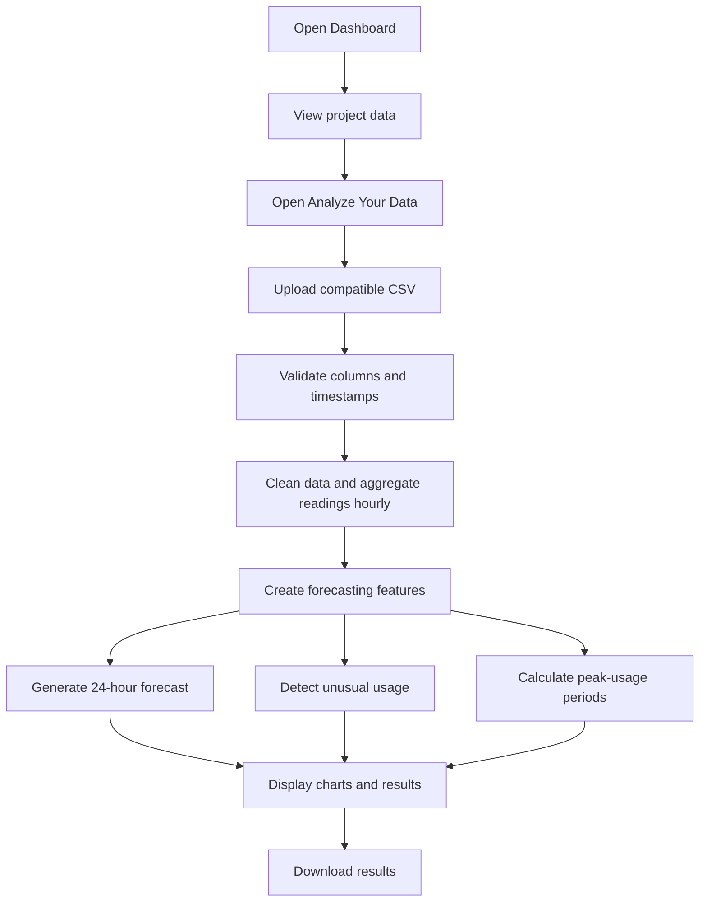
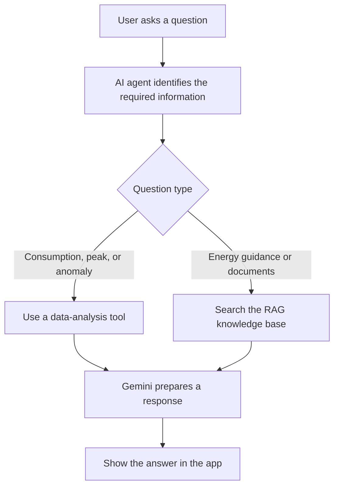

Pasted text mein purane chat replies aur workflow ke tukray bhi README ke saath mix ho gaye hain. Neeche **clean, complete version** hai—purana README poora replace karke ye paste karo.

`#` aur `##` raw README mein headings banane ke liye zaroori hain; GitHub par ye bade headings ki tarah render honge, literal `#` ki tarah nahi.

````markdown
# AI-Based Electricity Consumption Forecasting and Anomaly Detection

A Streamlit application for analyzing electricity consumption, forecasting future usage, detecting unusual readings, identifying peak-usage hours, and answering energy-related questions through an AI Assistant.

## Project Overview

The app processes historical electricity readings and displays consumption trends, forecasts, anomaly alerts, and peak-usage insights. Users can also upload a compatible CSV file and ask questions through the AI Assistant.

## Main Features

- Dashboard with consumption metrics and charts
- CSV upload and analysis
- 24-hour forecast using XGBoost
- Anomaly detection using Isolation Forest and the app's anomaly-analysis logic
- Peak-usage analysis by hour
- Downloadable forecast and anomaly results
- Gemini-powered AI Assistant with RAG-based document retrieval
- Light and dark themes

## How the App Works

The app has two main workflows.

### Data Analysis Workflow



### AI Assistant Workflow



The Dashboard initially shows project data. Uploaded CSV files are analyzed through **Analyze Your Data**.

## Dataset and Forecasting

The forecasting model was developed using the **UCI Power Consumption of Tetouan City** dataset. Its original readings are at 10-minute intervals and are processed into hourly data.

The XGBoost model uses historical, time-based, rolling, and weather features to generate a 24-hour forecast. The compatible upload format is:

```text
DateTime
Zone 1 Power Consumption
```

At least 200 hourly records are recommended. Forecast accuracy may vary for data from other locations or usage patterns.

## Anomaly Detection

The system flags readings that differ from expected consumption patterns. An anomaly is a statistical alert; it does not prove an appliance fault, electricity theft, or any specific cause.

## AI Assistant and RAG

The AI Assistant uses Gemini to answer natural-language questions. It can use consumption-analysis tools and retrieve relevant information from energy documents with RAG, Gemini Embeddings, and Chroma.

The assistant requires a Gemini API key. RAG retrieves document information; it does not train the forecasting model.

## Project Structure

```text
AI-Energy-Consumption-Forecasting/
├── Data/
│   ├── Tetuan City power consumption.csv
│   ├── hourly_electricity_data.csv
│   └── karachi_house34_hourly_weather.csv
├── Knowledge/
├── Models/
│   ├── anomaly_detection_config.pkl
│   ├── isolation_forest_anomaly_model.pkl
│   └── xgboost_electricity_forecasting_model.pkl
├── Notebooks/
├── Results/
├── VectorStore/
├── app/
│   ├── agent.py
│   ├── ai_assistant.py
│   ├── anomaly_detection.py
│   ├── app.py
│   ├── config.py
│   ├── data_processing.py
│   ├── forecasting.py
│   ├── rag.py
│   └── styles.py
├── .gitignore
├── README.md
└── requirements.txt
```

## Technology Stack

- **Data processing:** Python, Pandas, NumPy
- **Machine learning:** XGBoost, Scikit-learn, Joblib
- **Dashboard:** Streamlit, Plotly
- **AI and RAG:** Google Gemini, LangChain, Chroma, PyPDF

## Run Locally

Use Python 3.12:

```bash
git clone https://github.com/minhalalimeer38-beep/AI-Energy-Consumption-Forecasting.git
cd AI-Energy-Consumption-Forecasting

python -m venv .venv
.venv\Scripts\activate
pip install -r requirements.txt
streamlit run app/app.py
```

For local use, create a `.env` file in the project root:

```env
GEMINI_API_KEY=your_api_key
```

Do not commit `.env` or publish the real API key. On Streamlit Cloud, add the key under **Manage app → Settings → Secrets**.

## Model Evaluation

On the evaluated test period, the forecasting model achieved:

| Metric | Result |
|---|---:|
| MAE | 903.72 |
| RMSE | 1,217.75 |
| MAPE | 3.15% |

These results apply to that test period and are not guaranteed for every uploaded dataset.

## Limitations

- The forecasting model was trained on the Tetouan City dataset; performance may vary on other regions or households.
- Anomaly detection identifies unusual patterns but cannot determine their physical cause.
- AI responses depend on the Gemini API and the available knowledge documents.

## Links

- [Live application](https://ai-energy-consumption-forecasting.streamlit.app/)
- [GitHub repository](https://github.com/minhalalimeer38-beep/AI-Energy-Consumption-Forecasting)
````
